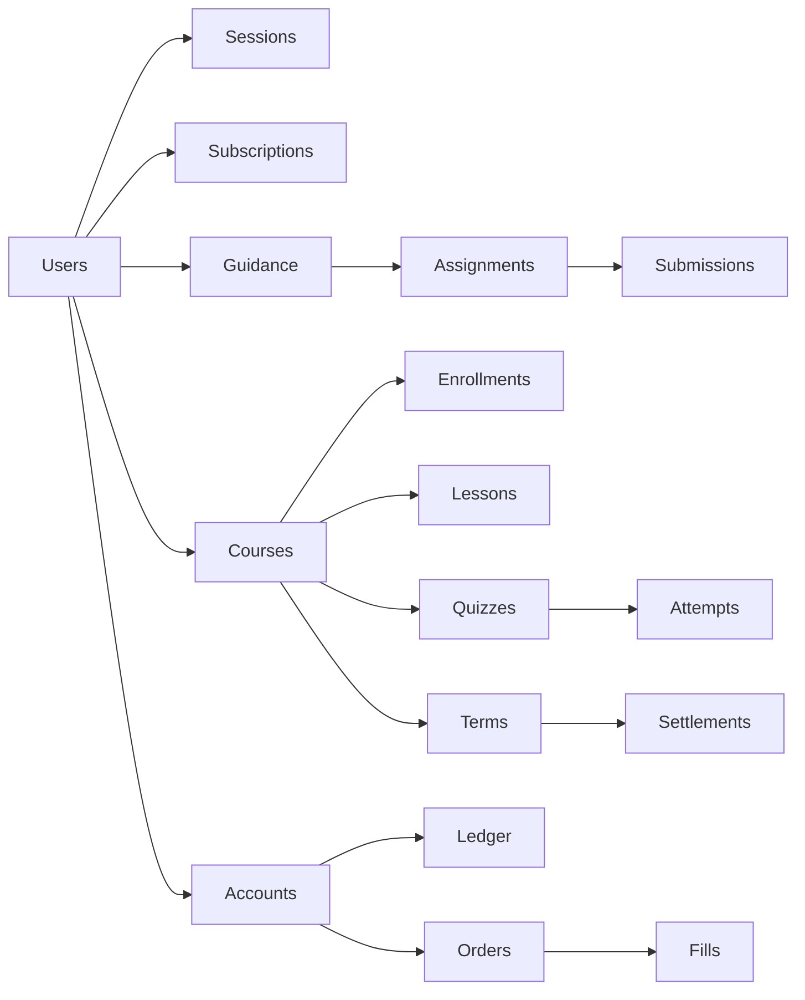

# Active SQLite schema

The schema is defined by the ordered files in `back-end/migrations/` and applied
by `back-end/db.js`. Users/sessions/challenges and applications establish identity;
subscriptions/payments/receipts/refunds track entitlements; guidance connects
students to staff. Courses/lessons/enrollments/progress, assignments/submissions,
quizzes/questions/attempts/answers and protected resources implement learning.
Instruments/accounts/orders/fills/positions/ledger support simulated trading.
Provider terms/settlements, notifications/delivery, tickets and audit support
administration. Check the actual migration DDL for exact names and constraints.

This is a domain overview, not a replacement for the migration constraints.
DataBase/ contains preserved legacy reference material; do not execute its MySQL
DDL against SQLite. Preserve already applied migration files and add new ordered
migrations for future changes. Keep database/WAL/SHM files out of version control.
